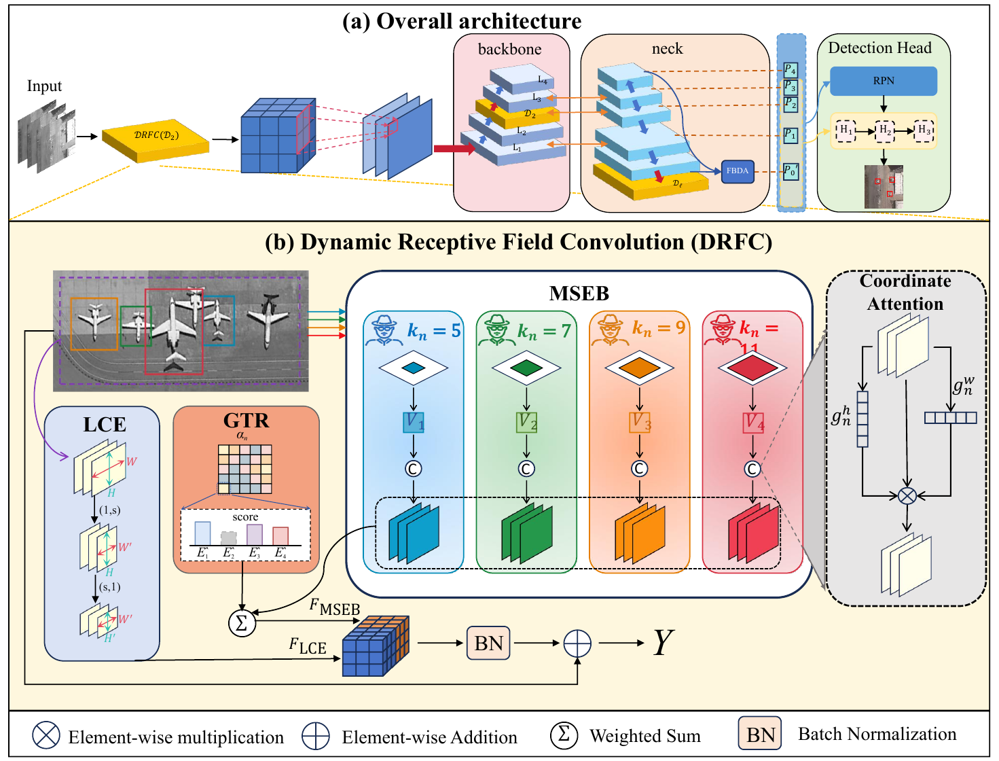

# RASA-Net

**Title:** RASA-Net for Small Object Detection With Adaptive Receptive Fields and Scale- and Quality-Aware Positive Allocation

**Authors:** Xiaoyu He, Xuehan Li, Zihao Chang, and Xiulin Geng

RASA-Net detects small objects in aerial and satellite imagery through region-adaptive receptive fields and scale- and quality-aware positive allocation. It addresses two challenges common in optical remote sensing. Small objects lose spatial detail during downsampling, and their limited overlap with anchors can leave them with few positive training samples.

- **Dynamic Receptive Field Convolution (DRFC)** routes each spatial region to convolutional experts with different receptive fields and combines their responses with directional context. It operates at the backbone stem, during downsampling, and at the highest-resolution pyramid level.
- **Scale- and Quality-Aware Positive Allocation (SQPA)** adjusts the number of positive candidates per object using object size, anchor overlap, and predicted foreground confidence under an image-level budget that changes during training.

Foreground–background decoupled attention suppresses clutter, and training-only Laplacian boundary supervision reinforces structural cues.



## Benchmark results

The manuscript reports COCO-style average precision (AP) for horizontal bounding boxes. Small-object AP uses boxes with areas of at most 32² pixels. SODA-A is evaluated on patches, and the other datasets are evaluated on original images.

| Dataset  | AP (%) | AP at IoU 0.50 (%) | Small-object AP (%) |
| -------- | ------:| ------------------:| -------------------:|
| DIOR     | 53.91  | 77.81              | 17.70               |
| HRRSD    | 61.71  | 89.07              | 21.29               |
| SODA-A   | 35.86  | 73.53              | 35.30               |
| VisDrone | 24.39  | 43.63              | 15.78               |

RASA-Net achieves the highest overall AP among the evaluated detectors on all four datasets. Small-object AP exceeds the strongest evaluated baseline by 1.49 points on DIOR, 1.28 points on SODA-A, and 1.42 points on VisDrone.

## Installation

Use a CUDA-enabled PyTorch and torchvision environment with a matching `mmcv-full` build in the range `1.3.3`–`1.4.0`. Follow the [MMCV 1.x installation guide](https://mmcv.readthedocs.io/en/v1.3.16/get_started/installation.html) for the compiled CUDA operators. From the repository root, install the bundled MMDetection package in editable mode.

```bash
python -m pip install -e .
```

## Dataset preparation

Download the datasets from Quark Drive using the corresponding access codes. Prepare images and COCO-format annotations at the paths in the configuration files.

| Dataset  | Download                                                     | Access code | Dataset root          | Configuration                                |
| -------- | ------------------------------------------------------------ | ----------- | --------------------- | -------------------------------------------- |
| DIOR     | [DIOR.zip](https://pan.quark.cn/s/dd446ecb35b2?pwd=L7Zm)     | `L7Zm`      | `data/DIOR_coco/`     | [DIOR](configs/ostd/ostd_dior_1x.py)         |
| HRRSD    | [HRRSD.zip](https://pan.quark.cn/s/5565eee34e88?pwd=Y6C9)    | `Y6C9`      | `data/HRRSD_coco/`    | [HRRSD](configs/ostd/ostd_hrrsd_1x.py)       |
| SODA-A   | [SODA-A.zip](https://pan.quark.cn/s/a22db407908d?pwd=qAP1)   | `qAP1`      | `data/SODA-A_coco/`   | [SODA-A](configs/ostd/ostd_sodaa_1x.py)      |
| VisDrone | [VisDrone.zip](https://pan.quark.cn/s/1e770ae2572e?pwd=UvYu) | `UvYu`      | `data/VisDrone_coco/` | [VisDrone](configs/ostd/ostd_visdrone_1x.py) |

## Training and evaluation

Run these commands from the repository root in Bash. Logs and checkpoints are written to `work_dirs/rasa_net_dior/`.

```bash
bash tools/dist_train.sh configs/ostd/ostd_dior_1x.py 3 work_dirs/rasa_net_dior --seed 0
```

After training, evaluate the epoch 12 checkpoint on the DIOR test split.

```bash
python tools/test.py configs/ostd/ostd_dior_1x.py work_dirs/rasa_net_dior/epoch_12.pth --eval bbox
```

## Contact

For questions about the paper, contact the author, Xuehan Li (`lxh2356338071@gmail.com`).
